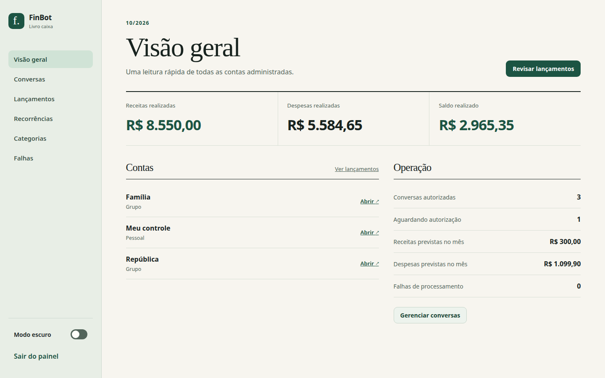
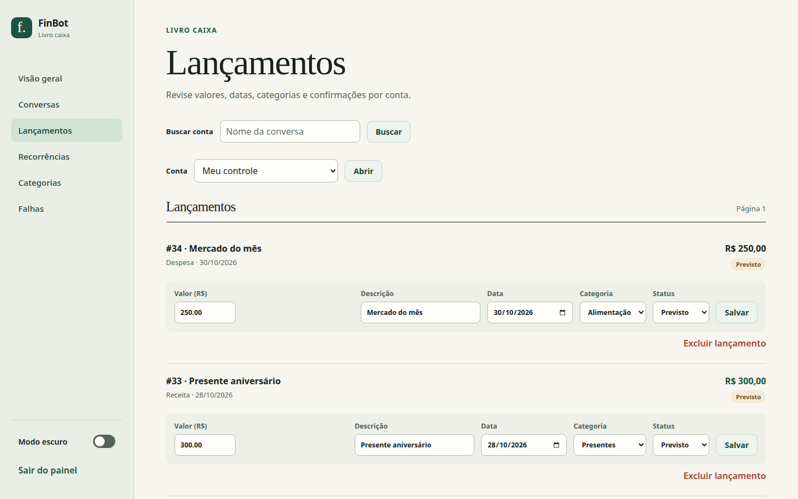
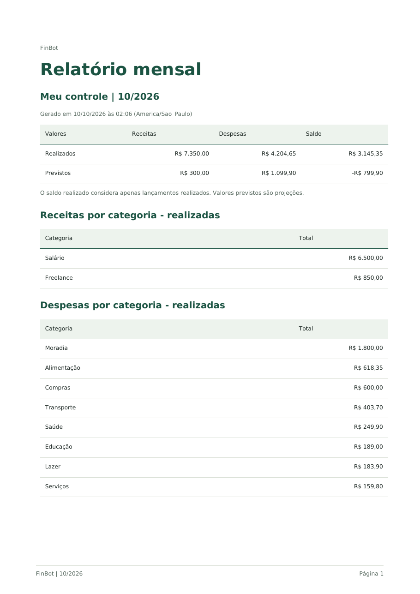
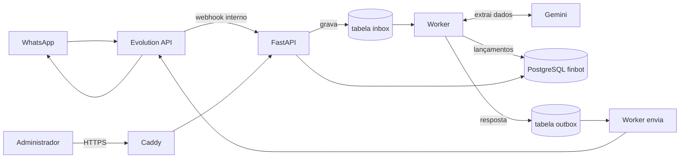

# FinBot

Bot financeiro de WhatsApp em português: você manda `/fin gastei 35 no almoço` e o lançamento é registrado, categorizado e consultável em um painel web.

[](https://github.com/ronaldosnb/fin_bot/actions/workflows/tests.yml)

[](LICENSE)



As imagens deste README usam dados fictícios.

## Funcionalidades

- Lançamentos de receitas e despesas em linguagem natural, categorizados automaticamente.
- Compras parceladas: o valor informado é o total e as parcelas vencem mês a mês.
- Recorrências diárias, semanais, mensais ou anuais, com ocorrências futuras geradas como previstas.
- Separação entre lançamentos realizados e previstos, com confirmação por comando.
- Relatório mensal em PDF enviado pelo WhatsApp.
- Consultas livres respondidas em texto, como "quanto gastei com alimentação no mês passado".
- Edição, exclusão e cancelamento de recorrência por comando.
- Contas individuais para conversas privadas e uma conta geral por grupo autorizado.
- Painel administrativo com autorização de conversas, lançamentos, categorias, recorrências, fila de falhas e modo escuro.

| Lançamentos no painel | Relatório mensal em PDF |
| --- | --- |
|  |  |

## Como funciona



O webhook recebe a mensagem, descarta o que não começa com `/fin` e grava o restante na tabela `inbox`. O worker lê a fila, pede ao Gemini os dados estruturados, grava no banco financeiro e enfileira a resposta na tabela `outbox`. Em seguida, o próprio worker envia a resposta pela Evolution.

### Componentes

- FastAPI: painel e webhook interno.
- Worker: interpreta comandos, cria ocorrências recorrentes e envia respostas.
- Dois serviços PostgreSQL isolados: `finbot` para dados financeiros e `evolution` para a Evolution.
- Redis: cache da Evolution.
- Evolution API v2.3.7: conexão WhatsApp via Baileys.
- Caddy: HTTPS do painel. O webhook só é acessado pela rede interna do Docker.
- Gemini API: interpretação e categorização de lançamentos de texto.

## Decisões técnicas

- **Fila `inbox`/`outbox` no PostgreSQL com `FOR UPDATE SKIP LOCKED`.** Evita um broker a mais e permite mais de um worker sem processar a mesma mensagem duas vezes.
- **Retentativa com espera crescente e estado `failed`.** Falhas temporárias da Evolution ou do Gemini se resolvem sozinhas. Após 5 tentativas o item vira `failed` e pode ser reprocessado pelo painel.
- **Idempotência por mensagem.** Restrições únicas em `inbox` (instância e id da mensagem) e em `entries` (mensagem de origem e índice do item) impedem lançamentos duplicados quando a Evolution reenvia um evento.
- **Valores em centavos inteiros.** Evita erro de arredondamento com ponto flutuante. Nas parcelas, o resto da divisão vai uma a uma para as primeiras parcelas, e a soma bate com o total.
- **Auditoria e exclusão lógica.** Edições, confirmações e exclusões gravam um registro em `audit`, e lançamentos excluídos ficam no banco com `deleted_at`.
- **Segurança do painel.** Senha com Argon2, cookie de sessão assinado e expirável, token CSRF nos formulários e bloqueio de login após 5 tentativas em 15 minutos por IP.
- **Privacidade.** Mensagens sem `/fin` são descartadas no webhook. Depois do processamento, o texto do comando sai da fila de entrada e o texto ou PDF da resposta sai da fila de saída após o envio. Lançamentos e auditoria permanecem no banco financeiro; mensagens com falha ficam na fila até revisão. Itens já processados são removidos das filas após 30 dias.
- **Webhook só na rede interna do Docker.** O Caddy responde 404 para `/webhook/*`, então o endpoint não fica exposto na internet.
- **A IA só extrai dados estruturados.** O Gemini devolve JSON com esquema fixo; categorias, limites de parcelas e conflito entre parcelamento e recorrência são validados em código.

## Comandos

```text
/fin ajuda
/fin gastei 35 no almoço
/fin recebi 2500 de salário
/fin comprei notebook por 1200 em 6x, primeira parcela em 10/10/2026
/fin pago aluguel de 1000 todo mês
/fin relatorio
/fin relatorio 09/2026
/fin quanto gastei com alimentação no mês passado
/fin listar
/fin confirmar 12
/fin editar 12 valor 42,50
/fin editar 12 categoria Alimentação
/fin editar 12 descricao Almoço de trabalho
/fin editar 12 data 25/09/2026
/fin excluir 12
/fin cancelar recorrencia 12
```

`/fin relatorio` envia um PDF do mês atual com um resumo na legenda; `/fin relatorio MM/AAAA` permite escolher o mês. O documento inclui receitas, despesas, saldo, totais por categoria e todos os lançamentos do período, separando realizados e previstos.

Consultas livres, como `/fin quanto gastei com alimentação no mês passado`, continuam em texto. O PDF é mantido na fila somente até o envio bem-sucedido; em caso de falha, pode ser reenviado pelo painel **Falhas**. Não há link público para o documento.

O bot interpreta um lançamento por comando. Se a data não vier na mensagem, usa a data de envio em `America/Sao_Paulo`.

Para parcelas, o valor informado é o **total** e a data indicada é o vencimento da primeira parcela; sem data, a primeira parcela vence na data da mensagem.

Ocorrências recorrentes futuras ficam previstas. A primeira ocorrência com data presente ou passada é marcada como realizada. Os relatórios mensais separam realizados e previstos.

Cada pessoa consulta e corrige somente sua conta privada. Em grupos autorizados, qualquer membro pode consultar e corrigir a conta geral do grupo. O painel mostra todas as contas, inclusive lançamentos e recorrências, e permite revisar mensagens que falharam.

## Preparação da VPS

Requisitos: Ubuntu/Linux com Docker e Docker Compose, um domínio apontado para a VPS, portas 80 e 443 liberadas, e uma chave da Gemini API criada no Google AI Studio. A porta 8080 da Evolution fica restrita a `127.0.0.1` da VPS.

1. Copie `.env.example` para `.env` e preencha `DOMAIN`, `ACME_EMAIL`, `OWNER_JID`, `GEMINI_API_KEY` e `EVOLUTION_INSTANCE`. O JID do proprietário usa o formato `55DDDNUMERO@s.whatsapp.net`.
2. Gere `POSTGRES_PASSWORD`, `EVOLUTION_DB_PASSWORD`, `APP_SECRET` e `EVOLUTION_API_KEY` com `openssl rand -hex 24`. Use apenas caracteres hexadecimais nas senhas do PostgreSQL para manter as URLs de conexão válidas.
3. Gere o hash da senha do painel:

   ```bash
   docker build -t finbot-setup .
   docker run --rm -it finbot-setup python -m app.password
   ```

   Copie a saída para `ADMIN_PASSWORD_HASH_B64` em `.env`. A senha digitada não fica no arquivo de configuração.
4. Restrinja a leitura de `.env` com `chmod 600 .env` e suba os serviços:

   ```bash
   docker compose up -d --build
   docker compose ps
   docker compose logs --tail=100 app worker evolution caddy
   ```

5. Acesse `https://SEU_DOMINIO/admin` e entre com a senha configurada.

O `migrate` aplica o esquema inicial antes de iniciar aplicação e worker. Cada serviço PostgreSQL cria seu próprio banco na primeira inicialização do volume.

## Conectar o WhatsApp

1. Crie um túnel SSH para acessar a Evolution sem publicar sua porta na internet:

   ```bash
   ssh -L 8080:127.0.0.1:8080 USUARIO@IP_DA_VPS
   ```

2. Abra `http://localhost:8080/manager` e informe `EVOLUTION_API_KEY`.
3. Crie uma instância **Baileys** com o nome exato de `EVOLUTION_INSTANCE` e conecte o QR code com seu WhatsApp.
4. Confirme no Manager que a instância está conectada e que o webhook está ativo. A configuração do container envia eventos `MESSAGES_UPSERT` para `http://app:8000/webhook/evolution` na rede interna.
5. Envie `/fin ajuda` em uma conversa privada ou grupo. A conversa aparecerá como pendente no painel; autorize-a em **Conversas**.

Sobre o chat "Mensagem para mim":

- A mensagem enviada a esse chat é aceita para o `OWNER_JID`.
- Se ela aparecer com um JID alternativo, configure-o em `OWNER_SELF_JID` e reinicie app e worker.
- A entrega de mensagens próprias pode variar conforme a sessão Baileys; faça esse ensaio antes de depender do bot.
- Se falhar, crie um grupo privado, envie `/fin ajuda`, autorize-o e marque **Grupo privado do dono**. Nesse modo, apenas comandos do proprietário são processados e os lançamentos entram na conta pessoal dele.

## Operação e backup

```bash
docker compose logs -f app worker evolution
docker compose ps
bash scripts/backup.sh
```

O backup contém os dois bancos e os arquivos de sessão da Evolution. Copie o diretório gerado para armazenamento fora da VPS. Faça um backup antes de atualizar imagens ou migrar o banco.

### Restauração

Use uma instalação com os mesmos segredos e uma versão de código compatível com o backup. Confirme os caminhos e pare os serviços que escrevem dados. A restauração abaixo **substitui dados atuais**; experimente em uma cópia antes de usar em produção:

```bash
docker compose stop app worker evolution
cat backups/SEU_BACKUP/finbot.dump | docker compose exec -T postgres pg_restore -U finbot -d finbot --clean --if-exists --no-owner
cat backups/SEU_BACKUP/evolution.dump | docker compose exec -T evolution_db pg_restore -U evolution -d evolution --clean --if-exists --no-owner
docker compose cp backups/SEU_BACKUP/evolution-instances evolution:/evolution/instances
docker compose up -d
```

Depois confira `docker compose ps`, os logs e a conexão da instância no Manager.

### Falhas, atualizações e rollback

- O estado `failed` em **Falhas** permite nova tentativa pelo painel. As tabelas `inbox` e `outbox` registram o andamento do processamento.
- Atualizações devem preservar os volumes PostgreSQL, Redis, Evolution e Caddy.
- Após atualizar a imagem, aplique `alembic upgrade head` antes de iniciar app e worker; o Compose já executa a migração antes dos processos. A migração dos relatórios em PDF acrescenta campos opcionais à fila de saída e preserva respostas de texto existentes.
- O rollback de código é voltar à imagem anterior e restaurar o backup caso a versão nova tenha alterado o esquema.
- Antes de voltar a imagem, aguarde o envio de todos os anexos pendentes e mantenha as novas colunas opcionais no banco. Reverter a imagem com PDFs ainda na fila faria o worker antigo tratá-los como respostas de texto.

## Desenvolvimento e testes

Para rodar os testes em um container, sem precisar de PostgreSQL:

```bash
docker build -t finbot-local-test .
docker run --rm -v "$PWD/tests:/srv/finbot/tests:ro" -e DATABASE_URL=sqlite:// -e OWNER_JID=owner@s.whatsapp.net finbot-local-test python -m unittest discover -s tests -v
```

A suíte usa um banco SQLite temporário em memória e simula os envios para a Evolution; não chama o Gemini nem a Evolution reais. O mesmo comando roda no GitHub Actions a cada push na `main` e em pull requests.

Para executar fora do Compose:

1. Use `SESSION_SECURE=false` em `.env` somente para acessar o painel por HTTP local.
2. Configure `DATABASE_URL` para um PostgreSQL acessível e instale `requirements.txt`.
3. Rode `alembic upgrade head`.
4. Inicie `uvicorn app.main:app --reload` e `python -m app.worker` em processos separados.

## Limitações conhecidas

- Um lançamento por comando.
- Apenas mensagens de texto; áudio, imagem e outros formatos não são interpretados.
- Sem controle de fatura de cartão de crédito.
- Depende de uma sessão Baileys, que é uma conexão não oficial com o WhatsApp e pode ser desconectada ou instável.

## Licença

Distribuído sob a licença MIT. Veja o arquivo [LICENSE](LICENSE).
